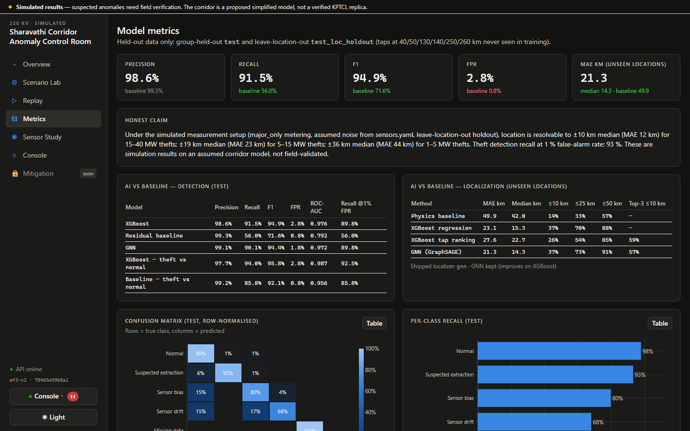
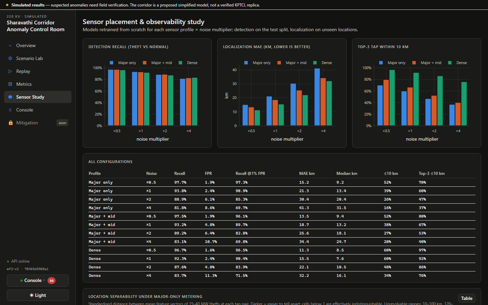
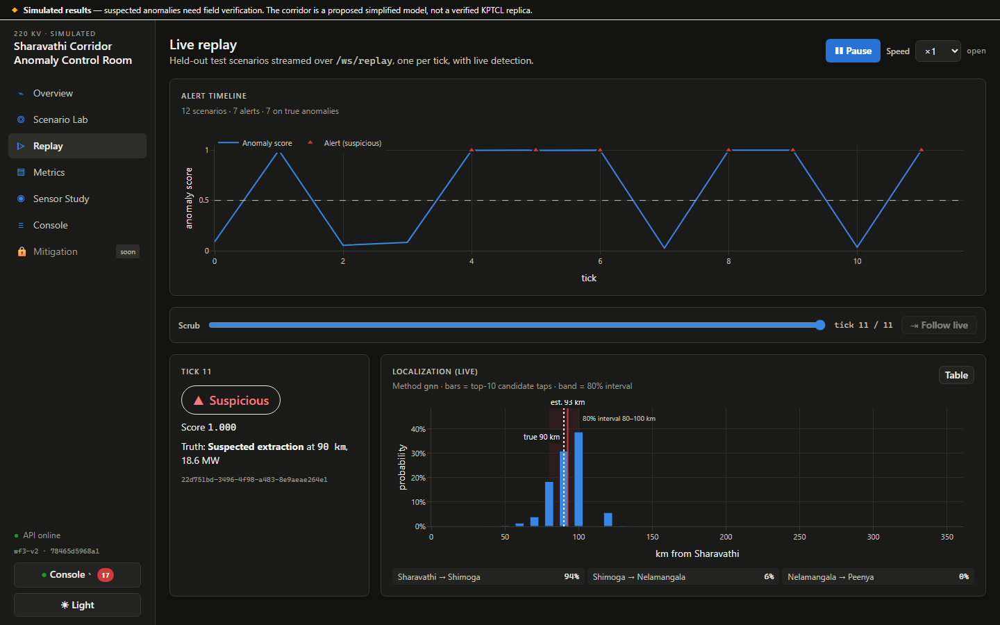
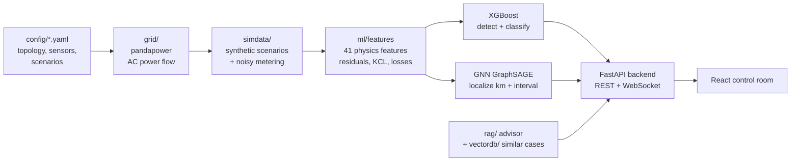
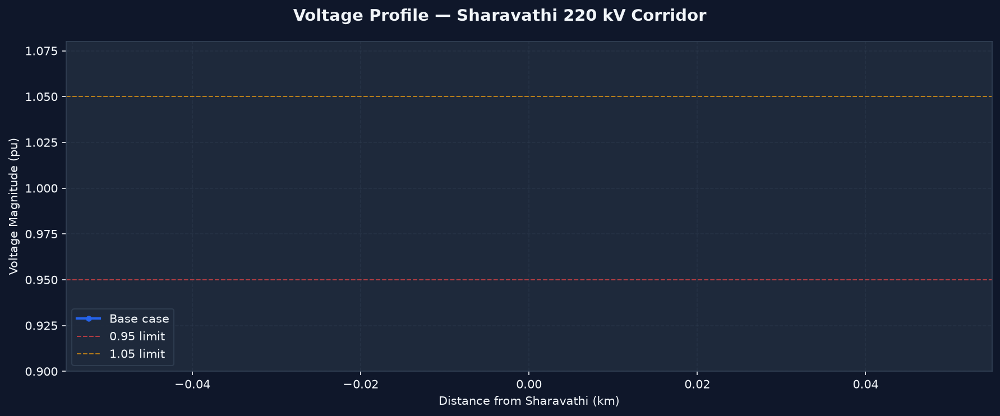

# Sharavathi Corridor — Power Theft Detection & Localization

Detects and **locates suspected unauthorized power extraction** on a simulated 361 km, 220 kV transmission
corridor from Sharavathi (generation) to Peenya, Bengaluru (load). It combines AC power-flow physics
(pandapower) with machine learning (XGBoost and a GraphSAGE graph neural network). Everything is shown in
an interactive web control room built with FastAPI + React.

> **Simulation only.** The corridor is a *proposed simplified model*, not a verified KPTCL replica, and every
> result is a *suspected* anomaly that needs field verification. The system never controls a real grid.


---

## Contents
- [What it does](#what-it-does)
- [Results](#results)
- [Quick start (Docker)](#quick-start-docker)
- [Run without Docker](#run-without-docker)
- [Using the app](#using-the-app)
- [How it works](#how-it-works)
- [Project structure](#project-structure)
- [Retraining from scratch](#retraining-from-scratch)
- [Tests](#tests)
- [Assumptions & limitations](#assumptions--limitations)

---

## What it does

| | |
|---|---|
| **Detect** | Is the corridor behaving normally, or is there an unexplained anomaly? |
| **Classify** | Is the anomaly likely an *extraction*, a *sensor fault* (bias / drift / missing data) or another network event? |
| **Localize** | Where along the 361 km line? It gives an estimated km, an 80 % interval and the most likely 10 km tap points. |
| **Advise** | Rule-based inspection steps plus a RAG advisor that answers with cited guidance passages. |
| **Study sensors** | How much do extra meters (Sira junction, every tap) improve detection and localization? |

The corridor has 5 substations. Only 4 are metered by default, so the Sira junction is *unmetered*. Each line is
split into **virtual tap buses every 10 km**; these are the candidate extraction points. A theft is simulated as a
real extra load at a tap, followed by a full AC power-flow re-run. Meter readings are never just edited.

## Results

All numbers come from held-out data: scenario groups never seen in training, plus a **leave-location-out** split
(taps at 40/50/130/140/250/260 km are never seen during training).

**Detection (test split, 1,919 scenarios)**

| Model | Precision | Recall | F1 | False-positive rate | ROC-AUC | Recall @ 1 % FPR |
|---|---|---|---|---|---|---|
| **XGBoost** | 98.6 % | **91.5 %** | **94.9 %** | 2.8 % | **0.976** | **89.8 %** |
| GNN (GraphSAGE) | 99.1 % | 90.1 % | 94.4 % | 1.8 % | 0.972 | 89.8 % |
| Residual baseline | 99.3 % | 56.0 % | 71.6 % | 0.8 % | 0.792 | 56.0 % |

**Localization (unseen locations, 1,155 scenarios)**

| Method | Mean error | Median error | Within 10 km | Within 25 km | Within 50 km |
|---|---|---|---|---|---|
| **GNN (GraphSAGE)** — used by the app | **21.3 km** | **14.3 km** | 37 % | 73 % | 91 % |
| XGBoost regression | 23.1 km | 15.3 km | 37 % | 70 % | 88 % |
| Physics baseline | 49.9 km | 42.0 km | 14 % | 33 % | 57 % |

The GNN numbers are the mean of 3 training seeds (test-split mean error 19.1 ± 0.8 km).
Bigger thefts are easier to place: the median error is about 10 km for 15–40 MW, 19 km for 5–15 MW and
36 km for 1–5 MW. Metering every tap (the *dense* profile) cuts the mean error from 21.3 km to 15.5 km.
See the Sensor Study page.

<table>
<tr>
<td></td>
<td></td>
</tr>
<tr>
<td align="center"><b>Metrics</b> — AI vs baseline on held-out data</td>
<td align="center"><b>Sensor Study</b> — 3 metering profiles × 4 noise levels</td>
</tr>
</table>

---

## Quick start (Docker)

The easiest way to run it: trained models and the dataset are included, so nothing needs training.

**Requirements:** [Docker Desktop](https://www.docker.com/products/docker-desktop/). On Windows, install
WSL 2 first by running `wsl --install` in an admin PowerShell and restarting.

```bash
git clone https://github.com/daiwik112/Threat-_detect-only.git
cd Threat-_detect-only/sharavathi-theft
cp .env.example .env          # Windows PowerShell: copy .env.example .env
docker compose up --build
```

The first build takes about 5–10 minutes (it downloads PyTorch). Then open:

| | URL |
|---|---|
| **Web app** | http://localhost:5173 |
| API docs (Swagger) | http://localhost:8000/docs |

Stop it with `Ctrl+C`, or `docker compose down`.

## Run without Docker

**Requirements:** Python 3.12, Node.js 20.

```bash
cd sharavathi-theft

# 1. Python dependencies (CPU-only PyTorch, then the pinned list)
pip install torch==2.14.1 --index-url https://download.pytorch.org/whl/cpu
pip install -r requirements.txt

# 2. Frontend dependencies
cd frontend && npm install && cd ..

# 3. Start the API (terminal 1)
cd backend && python -m uvicorn app.main:app --port 8000

# 4. Start the website (terminal 2)
cd frontend && npm run dev
```

Open http://localhost:5173. If you have `make`, the repo-root `Makefile` wraps all of this:
`make install`, `make dev`, `make test`, `make help`.

---

## Using the app

| Page | What you can do |
|---|---|
| **Overview** | Corridor diagram (metered ◉ vs unmetered substations), headline metrics, the "honest claim", assumptions. |
| **Scenario Lab** | Inject an extraction (location, MW), change load, noise, sensor profile or a sensor fault, then **Run**. See detection, likely cause, estimated location, recommended actions and the RAG advisor. **Reveal truth** shows the real location and the error. |
| **Replay** | Streams held-out test scenarios over a WebSocket, one per tick, with live detection and a scrubbable alert timeline. |
| **Metrics** | Precision/recall/ROC, confusion matrix, per-class recall, localization error vs baselines. |
| **Sensor Study** | Detection and localization for 3 metering profiles × 4 noise levels, plus which tap pairs are physically indistinguishable. |
| **Console** | Live activity log: user actions, simulations, alerts and API calls. Press <kbd>`</kbd> to open the dock from any page. |
| **Mitigation** | Placeholder for future load-balancing work (locked, "coming soon"). |

**Keyboard shortcuts (Scenario Lab):** <kbd>R</kbd> run · <kbd>T</kbd> reveal truth · <kbd>←</kbd>/<kbd>→</kbd> move the
injection ±10 km · **Live mode** re-runs on every change.

**Suggested 2-minute demo:** Scenario Lab → *Preset: Big theft near Shimoga* → **Run** → **Reveal truth** →
*Ask the advisor* → *Preset: Sensor bias only* → Run (the likely cause flips to *sensor error*). A longer script
is in [docs/DEMO.md](sharavathi-theft/docs/DEMO.md).

<table>
<tr>
<td></td>
<td></td>
</tr>
<tr>
<td align="center"><b>Overview</b> — corridor and headline metrics</td>
<td align="center"><b>Replay</b> — live stream of held-out scenarios</td>
</tr>
<tr>
<td colspan="2"></td>
</tr>
<tr>
<td colspan="2" align="center"><b>Console</b> — every action, simulation and alert, live</td>
</tr>
</table>

---

## How it works



1. **Grid model** (`grid/`): pandapower model of the 5-substation chain with 10 km tap buses, line parameters
   and loads from `config/topology.yaml`. Every assumed value is tagged `source: assumed`.
2. **Synthetic data** (`simdata/`): thousands of scenarios (normal operation at varied load, thefts of 1–40 MW at
   every tap, sensor bias/drift/missing data, network events). Each runs a full AC power flow, then adds
   realistic meter noise. Data is split by scenario group, and some locations are held out entirely, to prevent leakage.
3. **Features** (`ml/features.py`): 41 physics-informed features, such as residuals against the expected
   power flow, Kirchhoff current-law consistency between metered ends, and loss mismatches.
4. **Models** (`ml/`): a residual-threshold **baseline**, **XGBoost** for detection and 6-class cause
   classification (with SHAP explanations), and XGBoost regression/tap-ranking plus a **GraphSAGE GNN** for
   localization with calibrated 80 % intervals. The GNN is used because it beats XGBoost on unseen locations.
5. **Backend** (`backend/`): FastAPI endpoints for simulate → analyze, metrics, sensor study, scenario replay
   (WebSocket), activity events (WebSocket), the RAG advisor and similar-case search.
6. **Frontend** (`frontend/`): React + TypeScript + Vite, Plotly charts, React Flow corridor diagram,
   TanStack Query, Zustand and Tailwind. Built for keyboard access, with Lighthouse accessibility 96–100 on every page.

**Tech stack:** Python 3.12 · pandapower · scikit-learn · XGBoost · SHAP · PyTorch + PyTorch Geometric ·
FastAPI · React 18 · TypeScript · Vite · Plotly · React Flow · Tailwind · Vitest · Playwright · Docker

<details>
<summary>Grid diagnostics (voltage profile and theft effect)</summary>



</details>

## Project structure

```
.
├─ README.md
├─ Makefile                  # make help — all common commands
├─ 00_README_MASTER.md … 09_RAG_MODULE.md   # design specs per workstream
└─ sharavathi-theft/
   ├─ config/                # topology.yaml, sensors.yaml, scenarios.yaml, feature_flags.yaml, rag.yaml
   ├─ grid/                  # pandapower corridor model
   ├─ simdata/               # scenario + dataset generator
   ├─ ml/                    # features, baseline, XGBoost, localizers, gnn/, evaluation, sensor study
   ├─ rag/                   # RAG advisor (corpus of inspection playbooks, retriever, generator)
   ├─ vectordb/              # similar-case search over the feature embedding
   ├─ future/                # mitigation / load-balancing interfaces (stubs)
   ├─ backend/               # FastAPI app + tests
   ├─ frontend/              # React app, Vitest unit tests, Playwright e2e tests
   ├─ data/
   │  ├─ raw/                # baseline operating states
   │  ├─ processed/          # main dataset (parquet) + splits
   │  └─ models/             # trained models, metrics.json, sensor_study.json, gnn_results.json
   ├─ docs/                  # DEMO.md, screenshots/
   ├─ tests/                 # Python tests (grid, simdata, ml, rag, vectordb, future)
   ├─ requirements.txt
   └─ docker-compose.yml
```

## Retraining from scratch

The repo ships with trained models, so this is optional. Run from `sharavathi-theft/` (or use the `make`
target in brackets):

```bash
python -m simdata --profile major_only --seed 42 --n-jobs 8   # (make data)        dataset
python -m ml.train                                            # (make train)       all models + metrics.json
python -m ml.train --skip-gnn                                 # (make train-fast)  ~90 s, no GNN
python -m simdata.study_datasets --n-jobs 16 --skip-existing  # (make study-data)  12 study datasets, slow
python -m ml.sensor_study                                     # (make sensor-study)
python -m rag.ingest                                          # (make rag-index)   RAG advisor index
python -m vectordb.cases                                      # (make vector-index) similar-case index
```

The GNN trains 3 seeds on CPU and can take a few hours. The sensor-study datasets are about 350 MB and are not
committed to Git.

**Optional — LLM answers in the RAG advisor:** set `ANTHROPIC_API_KEY` in `.env`. Without a key, the advisor
works offline and answers with extracted, cited passages. Never commit a real key.

## Tests

```bash
cd sharavathi-theft
python -m pytest tests                 # grid, simulation, ML, RAG, vector DB (124 tests)
cd backend && python -m pytest tests   # API (30 tests)
cd ../frontend && npm test             # React components (21 tests)
npx playwright test                    # full-stack browser tests (11 tests; starts API + web if not running)
```

## Assumptions & limitations

- The 5-substation chain and its distances (Sharavathi 0 km → Shimoga 110 → Sira/KB-Cross 215 → Nelamangala 320 →
  Peenya 361) are a **proposed simplified model**, not verified KPTCL/SLDC data. Edit `config/topology.yaml` when
  real data is available.
- Line parameters, loads and sensor noise (`config/sensors.yaml`) are **assumed** values.
- Results are from simulation only and have not been validated in the field. Thefts under about 5 MW sit close to
  the meter noise floor, and some neighbouring tap pairs cannot be told apart with only major-substation metering
  (see Sensor Study).
- Outputs use the wording *"suspected unauthorized extraction"*, never "theft confirmed".
- Load balancing / mitigation is **not implemented**. Only the interfaces and a locked UI tab exist.
